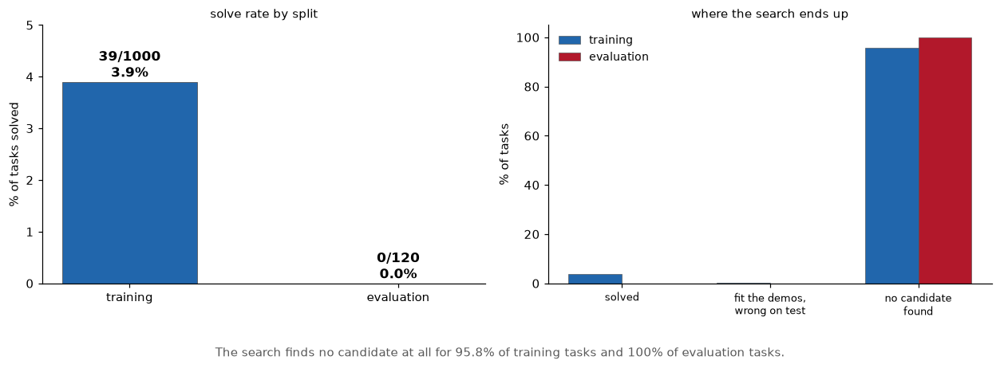
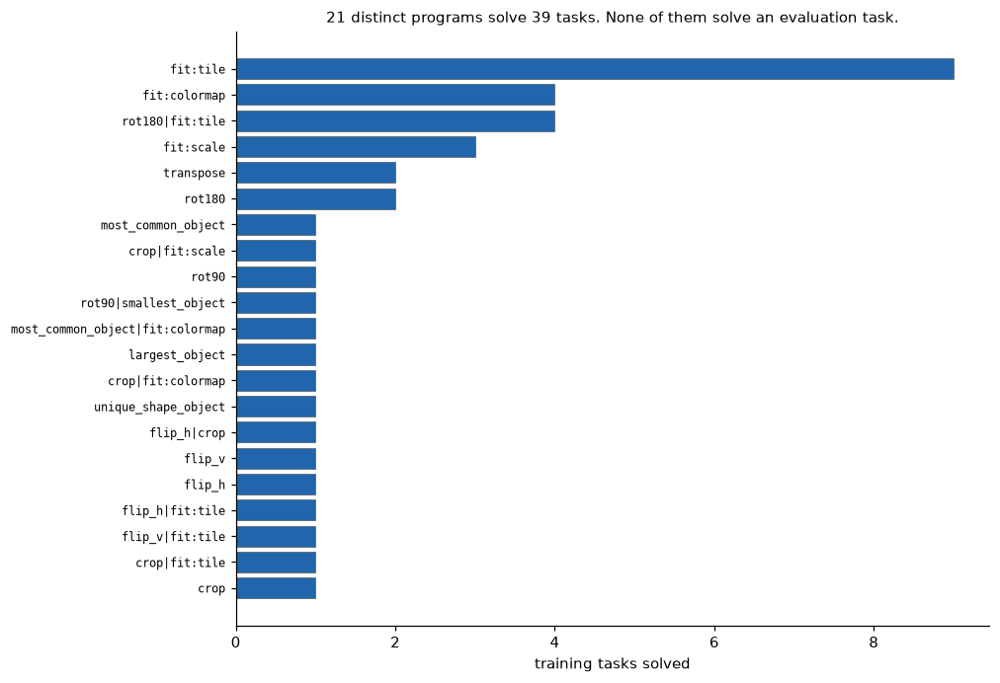
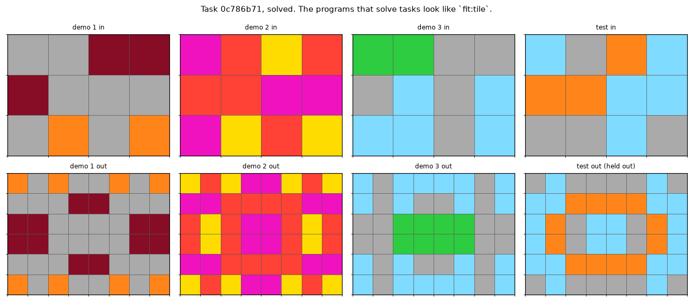

# ARC-AGI-2, a program-synthesis attempt that scores 0.00 on the leaderboard

[](https://github.com/aghasalim/arc-prize-2026/actions/workflows/ci.yml)
[](https://www.python.org/)
[](LICENSE)
[](https://doi.org/10.5281/zenodo.23003614)

This is my attempt at [ARC Prize 2026 / ARC-AGI-2](https://www.kaggle.com/competitions/arc-prize-2026-arc-agi-2).
I built an object-centric DSL with a program search that checks each candidate
against the examples. It didn't work, and I'm reporting it as a failed attempt,
with the number that shows it.

My write-up for the ARC Prize paper track is on Kaggle as
[Nothing to Verify](https://www.kaggle.com/competitions/arc-prize-2026-paper-track/writeups/nothing-to-verify-why-a-verified-dsl-search-score),
and the source is in [paper/PAPER.md](paper/PAPER.md).

**Here are the results first.**

| split | tasks | solved | |
|---|---|---|---|
| public training | 1,000 | **39** | 3.9% |
| **public evaluation** | 120 | **0** | **0.0%** |

That's a real zero, nothing got rounded down. The search didn't get a single
one of the 120 evaluation tasks right. In fact, on 120 of 120 it produced no candidate
program at all, not even a wrong one.

I'm putting that first because the score is the least interesting part, and
hiding it would make this look like something it isn't. The grand prize needs
85%. A DSL search I wrote alone was never going to get close. What I actually got
out of it is a better idea of *why* the gap looks the way it does.

The rest of this page goes through that, more or less in the order I figured it
out.

---

## The 3.9% → 0% collapse is not sampling noise

With 120 tasks you might wonder if it's just noise. It isn't. My solver
produced **zero candidate programs** on the eval set. Nothing in its vocabulary
fit even the demonstration pairs, never mind the test. The search finds no candidate at all for
95.8% of training tasks and 100% of evaluation tasks. So the verifier isn't
throwing away good candidates. There just aren't any candidates for it to look
at.

I measured how the two splits differ.

| | training | evaluation |
|---|---|---|
| mean input cells | 182 | **373** (2.05×) |
| distinct colours per task | 5.39 | **7.06** |
| demo pairs per task | 3.23 | **2.99** |

Those three rows come from [`scripts/split_stats.py`](scripts/split_stats.py).
It writes one row per task to `reports/task_stats.csv` and the summary above to
`reports/split_stats.csv`.

The evaluation tasks have bigger grids, more colours, and *fewer* examples to
work out the rule from. That's on purpose. ARC-AGI-2's evaluation set is picked
so that tasks a shallow transformation search can solve get filtered out. My
solver is exactly the kind of thing it was designed to keep out, and it did.



The right-hand panel is the more important one. The search doesn't produce any
candidate for 100% of evaluation tasks. So the problem is in generating programs,
and the verifier never even gets anything to reject.

## Twenty-one programs, and the ceiling they draw

Twenty-one distinct programs account for the 39 training solves. Looking at how
they're spread out tells you a lot. There are a few broad transforms and then a
long tail of one-offs. I wrote every one of them after looking at training tasks,
and that kind of generalisation is exactly what the evaluation split is built to
block.

**This is what solved the 39 training tasks.**

| primitive family | tasks |
|---|---|
| tiling (fit:tile, incl. mirrored/composed) | 16 |
| geometric only (rot/flip/transpose) | 7 |
| colour map (fit:colormap) | 6 |
| integer upscale (fit:scale) | 4 |
| object selection | 4 |
| crop to content | 2 |

Every one of these is a *single global rule* applied to the whole grid. None of
them counts anything, uses conditions, or applies a different rule per object.
Those are the things the eval tasks need.




## The verifier is weaker than it looks, and Kaggle hides that

A candidate only gets accepted if it reproduces **every** demo pair exactly. With
2 or 3 demos that's not much of a guarantee, and `evaluate.py` measures how weak
it is. Out of the 42 training tasks where the search believed it had the rule, 3 fit every demo and
still got the test grid wrong. That's 7%. A leaderboard can never show you that
number, because on Kaggle those 3 look exactly the same as the 958 tasks that
produced no candidate at all. The second allowed attempt only bought 1
task, since 38 of the 39 were already solved on attempt 1.

The full working is in [notes/METHODS.md](notes/METHODS.md#3-the-verifier-and-the-number-it-hides).

## The GNN I came in wanting, and the half of it that survived

I started out wanting to use graphs, and in the end I kept half of that idea.

A GNN as the solver would score about 0, and tuning wouldn't fix it. Each ARC
task defines a new rule from 2 or 3 examples, so there's no shared function
across tasks that gradient descent could learn. The part I kept is the object
representation. `grid.py` parses every grid into connected components, and 4 of
the 39 training solves are object selection. So I dropped the learned weights
and kept the structure.

The full working is in [notes/METHODS.md](notes/METHODS.md#2-why-program-synthesis-and-not-the-gnn-i-originally-wanted).

## The submission, predicted before it was scored

**Submitted and scored: `0.00` on the ARC Prize 2026 / ARC-AGI-2 leaderboard** (submission 55509993, notebook [ARC-AGI-2 DSL search v2](https://www.kaggle.com/code/aghasalimmustafazada/arc-agi-2-dsl-search)).

Before I submitted, I wrote in this README that I expected a score at or very
near 0%, and that's what the hidden test set gave. The hidden set has 240 tasks,
twice the 120 in the public evaluation split, so the 0 of 120 wasn't just bad
luck with which 120 tasks I had. There's one weakness in what I submitted.
`attempt_2` is the same as `attempt_1` on every task, because when there's no
candidate the fallback copies the input into both. So the second attempt added
nothing.

The full working is in [notes/METHODS.md](notes/METHODS.md#5-kaggle-submission-scored-000-as-predicted).

---

## Running the whole thing yourself

```bash
make setup && make test
```

```bash
make eval-train && make eval
```

The task data is the public [ARC-AGI-2 repo](https://github.com/arcprize/ARC-AGI-2)
(Apache-2.0), copied into `data/`. You don't need Kaggle credentials to reproduce
any number above. Separate implementations in `verify/` also rebuild those numbers
from the raw task files, and CI fails if any of them disagree.

## Three next moves, by expected value rather than effort

1. Stop adding to the DSL by hand. Doubling the search depth is the simplest way
   to add vocabulary. It moved training from 2.7% (27 tasks at depth 1) to 3.9%
   (39 tasks at depth 2), and evaluation stayed at 0% either way. Writing
   primitives by hand gets even less than that for each hour I put in.
2. Let an LLM propose candidate programs and keep this search as the checker. The
   verifier is the part of what I built that I can reuse.
3. Try test-time adaptation, since every task in this benchmark is a new rule.

The full working is in [notes/METHODS.md](notes/METHODS.md#6-what-id-do-next-honestly).

MIT licensed. Task data from [ARC-AGI-2](https://github.com/arcprize/ARC-AGI-2)
under Apache-2.0.

## Reading behind this

- **Chollet. On the Measure of Intelligence. 2019.** [arXiv:1911.01547](https://arxiv.org/abs/1911.01547) ARC and the skill acquisition efficiency argument behind it.
- **Chollet, Knoop, Kamradt, Landers, Pinkard. ARC-AGI-2: A New Challenge for Frontier AI Reasoning Systems. 2025.** [arXiv:2505.11831](https://arxiv.org/abs/2505.11831) the benchmark this targets.
